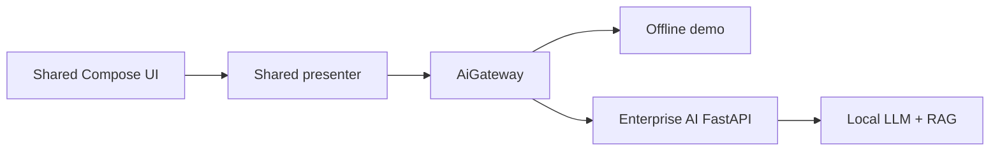

# Enterprise AI KMP Client

> A Kotlin Multiplatform client with shared Compose UI and business logic for a private enterprise AI platform.

This repository shows how a production mobile/desktop client can sit on top of the [Enterprise AI Platform Showcase](https://github.com/maxlord/enterprise-ai-platform-showcase). It is intentionally focused: shared state and UI, evidence-aware answers, offline demo mode, a real JVM HTTP transport, desktop packaging, and an iOS framework target.

## What it demonstrates

- Kotlin Multiplatform source-set architecture;
- Compose Multiplatform UI shared across targets;
- clean `AiGateway` boundary between UI/business logic and transport;
- a runnable desktop client using `java.net.http`;
- iOS device and simulator frameworks;
- offline demonstration without API keys or infrastructure;
- common tests for state and business behavior;
- opt-in GitHub Actions verification with no workflow on push.



## Run

Offline demo:

```bash
./gradlew :composeApp:run
```

Connect to a locally running backend:

```bash
ENTERPRISE_AI_API_URL=http://localhost:8080 ./gradlew :composeApp:run
```

## Verify

```bash
./gradlew :composeApp:desktopTest
./gradlew :composeApp:compileKotlinIosSimulatorArm64
```

The CI workflow runs only on pull requests or manual dispatch.

## Production evolution

The simple JVM transport keeps the showcase reviewable. A customer implementation would normally use Ktor with typed serialization, authentication/refresh flows, certificate pinning where appropriate, encrypted persistence, tenant-aware source rendering, analytics with privacy controls, and Android/iOS application shells.

## Related

- [Enterprise AI Platform Showcase](https://github.com/maxlord/enterprise-ai-platform-showcase)
- [Discuss a project](https://github.com/maxlord/maxlord/issues/new/choose)
